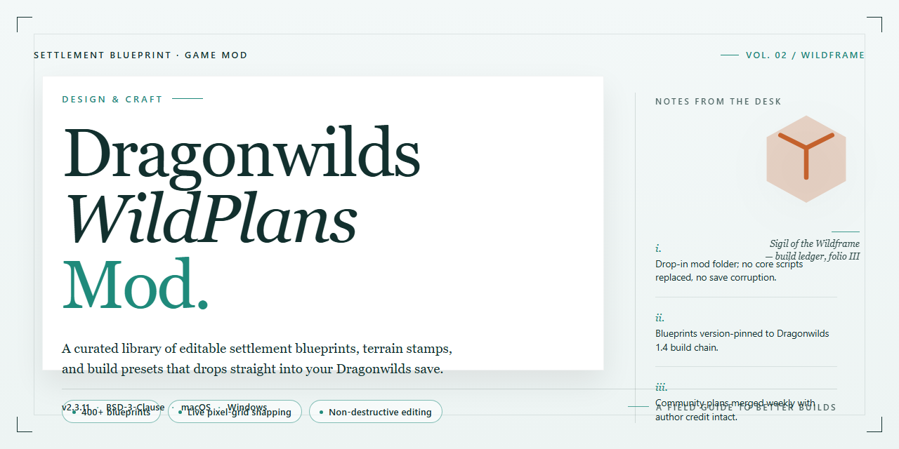

# 🐉 Dragonwilds WildPlans: Ghost Blueprint Builder Mod for Windows

### 📦 PowerShell Install Button

  

---

Dragonwilds WildPlans turns every structure raise into reusable blueprint, letting favorite build and summon the game's own ghost pieces — no foreign props, no terrain tricks, just the system doing what already does. Built client-side mod, slots into your existing controls and keeps blueprints plain-text files can copy, share, and archive like any other save. If 've ever looked at hard-won fortress and thought "I want that here too," this is the mod that makes happen. Tinker freely — everything lives in readable files, and your keys stay yours.

## 📋 System Requirements

- **OS:** Windows 10 / 11
- **Shell:** PowerShell 5.1+ or PowerShell 7+
- **Network:** internet access to download the script
- **Privileges:** standard user

## Features

**Everything build, ready to build.** WildPlans turns the game's own ghost pieces into personal library of structures. tower, gatehouse, sprawling cliffside manor — then the ground allows, snapped into the world the game's native blueprints, not hack or prop dump.

- **📸 the world around ** — One keypress sweeps up the player-built structure nearest (within 100 meters) and asks what to call. No menus, no tedium, just name and 's yours.
- **🏗️ Replay in or drop ** — Reveal ghost of the original exactly where stood, or enter placement mode and let the pieces settle into new horizon. 's your design, reissued.
- **📖 blueprint panel that actually respects your time** — The N-key panel lists every blueprint own, those already standing in the current world up front, and shows piece counts at glance. Hover for details, click to pin, click to let go.
- **🧱 Real material accounting** — Before commit, the DETAILS view breaks down the build piece by piece and material by material. Know what costs before lay the first stone.
- **📍 Placements ledger** — Every blueprint 've ever placed is tracked. Jump to with waypoint on your compass, inspect what's there, or remove piece by piece with confirmation step that refuses to let undo mistake by accident.
- **⌨️ Keys that bend to your setup** — Remap, placement, and the two shortcuts right inside the game's Settings > Controls menu under WILDPLANS (MOD). Letters, numbers, F-keys, and full Ctrl/Alt/Shift combos are fair game.
- **💾 Plain-text, portable blueprints** — Each is single `.wplan` file, human-readable and easy to share. Copy one file to friend, and the structure travels with.
- **🧾 Honest logging** — Every action the mod takes lands in logs folder, ready to attach to bug report. No mystery failures.

**Modder-friendly by design.** WildPlans leans entirely on the game's own ghost-piece placement, which means plays nicely with how the game sees your structures and won't fight the base build system. The blueprint format is plain text and the placement ledger is one tidy file — poke at, back up, or hand around. Your keys, your files, your builds.

## Installation

Getting WildPlans into your world is quick ritual — no arcane configs, no dependency trees to untangle. Here's the path.

**First, the foundation.** WildPlans rides on top of, the script extender that gives mods foothold in the game. Set up compatible build for Dragonwilds before anything else; without, the mod has nothing to latch onto.

**Then the drop.** Take the WildPlans mod folder and where expects to find mods — inside the game's mod directory, alongside your other script mods. Keep the folder intact; the internals know where they belong.

**Wake up.** Launch the game once so can register the new arrival, then open the mods configuration and make sure WildPlans is enabled. If keep load-order list, tuck WildPlans in after your core libraries but before anything that touches the UI.

** quick wander to confirm.** Load into world 've already built in, press the panel key, and watch for the blueprint list to appear. If does, 're in. If not, check the mod's log folder and the log — those two will usually tell exactly which step went sideways.

**Keeping fresh.** When game patch drops, treat WildPlans like any other script mod: re-verify 's still enabled after the update, and if the panel or placement misbehaves, swap in newer build meant for that patch. Your captured blueprints live safely in their own folder, so updates won't eat your work.

** note on where things live.** Your blueprints, placements, keybinds, and logs all settle into the mod's own saved folder inside your local app data. Back that folder up before big changes and 'll never lose structure poured hours into.

## Compatibility & Limits

**Compatibility & Limits**

WildPlans is built to slide into your load order like well-fitted brick — but every castle has walls, so here's the honest map of where the mod plays nice and where draws line in the dirt.

**What gets captured, and what's stubborn**

Only the pieces placed with your own two hands end up in blueprint. The game's scenery — trees, rocks, terrain, decorative world props that came with the map — refuses to be swept up. 's not bug; those things simply aren't "yours" in the way wall or foundation is. So if lovely cliffside manor, expect the manor, not the cliff.

**Real placement has Creative streak**

The `O` shortcut for real, material-free placement is Creative-world luxury. else, WildPlans still gives the ghost layout — that satisfying phantom skeleton of your build — and from there finish the job the honest way, feeding the build menu material by material. Think of blueprint on parchment rather than magical instant castle.

**Patches are the wild card**

Game updates have habit of shuffling piece data around, and WildPlans leans on that data to know what 's looking at. If your panel goes quiet or placement starts acting strange after patch drops, that's your cue to swing by and grab the freshest WildPlans release — the mod gets refreshed to match the game's new furniture.

**Servers: client-side only, and proud of **

Nothing is installed on the server. WildPlans lives entirely on your machine, which means plays along with dedicated servers just fine —, ghosts, real placement, even beefy 464-piece placement, undo, and the whole dance after restart. There are two small wrinkles worth knowing. First, undo and IN only notice pieces close enough to see, since the mod can only read what your client has loaded. Second, the server saves on five-minute heartbeat, so anything in the final moments before server restart can slip away unrecorded., then breathe, then restart.

**One mod, many worlds**

WildPlans can't tell one server from another, so PLACEMENTS shows the history from every server 've visited, all in one list. Removing placement is careful about — only deletes pieces that match exactly, piece by piece and position by position, and asks to CONFIRM before anything vanishes. Nothing goes missing by accident.

**The untested frontier**

Two scenarios haven't been put through the wringer yet: several players on single server at the same time, and co-op worlds hosted by player rather than dedicated machine. They may work beautifully; they may have quirks. If venture into those wilds, 're helping chart the map.

**If something feels off**

Your `logs` folder and the `\.log` are the breadcrumbs worth attaching to any bug report — they tell the story of what the mod tried and where tripped.

## Credits

WildPlans exists because one builder looked at finished hall, winding stair, whole cliffside town, and thought: *that shouldn't have to be built twice.* Every piece of this mod grew out of that single stubborn idea, and only ever took shape because the Dragonwilds community kept asking for more.

**The builders.** are the reason this mod has anything to do. Every blueprint captured, every ghost placed, every "can also do—" posted somewhere — that's the fuel. The mod was built to keep up with, not the other way around. If feature feels like was for your specific tower, that's because probably was.

**The tinkerers.** To everyone who edited the key file by hand, renamed blueprint mid-project, shared `.wplan` with friend, or broke something and reported with the logs attached — 're the unofficial QA, and the mod is steadier for.

**The patient ones.** To the server crews who tested and placement across dedicated worlds, and especially to whoever 464-piece placement work and then rebuilt all over after restart: that's the kind of dedication that turns script into tool.

**The game.** Credit where 's truly due — the ghost-piece placement system belongs to the game itself. WildPlans doesn't invent new way to build; hands way to *remember* the way already did. Respect to the people who those pieces feel worth reusing.

**The engine room.** This mod rides on the shoulders of the modding framework that makes client-side possible in the first. Without that groundwork, none of the panel, the mode, or the pin-and-replay dance would exist.

And finally — to anyone who opens the panel, presses the key, and watches an old build bloom back into ghost pieces exactly where stood: that moment is the whole point. Go build something worth capturing twice.

## License

The WildPlans mod is yours to shape. Copy, remix, fold into your own builds, hand to friend — the license is plain old MIT, and means what says: free to use, change, and share, provided the original copyright notice stays put in any copy or substantial portion pass along. No royalties, no gatekeeping, no asking permission first.

comes is, though — builder's honesty. If patch reshuffles piece data or server hiccups and blueprint misbehaves, that's on the road, not on the modder. Use, enjoy, and if build something strange and wonderful on top of, all the better.